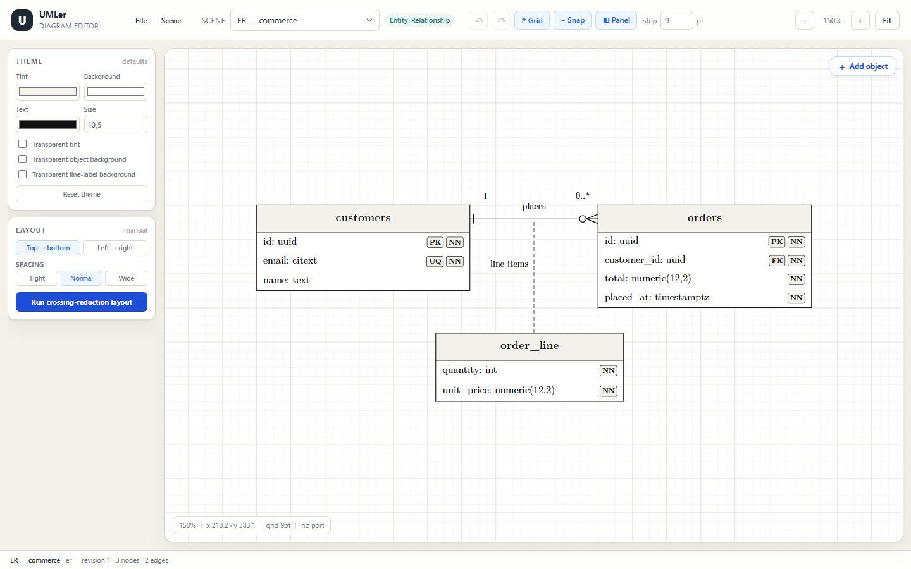

# UMLer

A UX-focused editor for **ER** and **UML** diagrams — Use Case, Class, Sequence, Communication and State Machine
— with a skeleton-first interactive canvas and a **Typst + CeTZ** rendering/export core.

> **Current checkpoint: Step 3 complete — editing, routing, auto-layout and GitHub project sync.**
> The repository contains the notation research and scene schema (Step 1), the SVG grid canvas and
> measurement/snap pipeline (Step 2), and the Step 3 editor layer: sparse orthogonal A* routing with
> point-and-double-click reroute, layered crossing-reduction layout with lock constraints, table content
> editing, edge/endpoint marker popovers, label quick-select and label collision avoidance.



## Run it

```bash
npm install
cp .env.example .env.local   # optional: add a GitHub OAuth App client id
npm run dev      # http://127.0.0.1:5173/
npm run check    # typecheck + scene validation + layout/persistence/GitHub/storage tests
npm run build
```

GitHub features work in `npm run dev` and `npm run preview`. OAuth uses the device flow, so no
client secret is stored or shipped; set `GITHUB_OAUTH_CLIENT_ID` (or paste the public client id
in the dialog once) after enabling **Device flow** on a GitHub OAuth App.

The Vite config uses `--configLoader native`. Vite's bundled config loader spawns a helper process that the
current Windows sandbox blocks with `spawn EPERM`; the native loader is a supported Vite option and the app
builds and runs normally.

## Read this first

| Document | What it covers |
|---|---|
| [00 — Notation research](docs/00-notation-research.md) | Visual conventions and formalities for ER + the six UML diagram types |
| [01 — CeTZ mapping](docs/01-cetz-mapping.md) | How every primitive maps to CeTZ 0.5.3 `anchors`, `rect`, `line`, `ortho`, `mark`, `content` |
| [02 — Architecture](docs/02-architecture.md) | Two-phase skeleton → CeTZ pipeline, auto-layout, A* routing, parity contract |
| [03 — Step 1 scene graph](docs/03-step1-scene-graph.md) | TypeScript schema, invariants, fixtures, review decisions |
| [04 — Step 2 canvas](docs/04-step2-canvas.md) | Camera/grid/measurement/snap pipeline and Step 2 verification |
| [05 — Step 3 editor](docs/05-step3-editor.md) | A* router, layered auto-layout, endpoint menus, table editor, label rules, verification |

## Repository layout

```text
src/model/        framework-agnostic scene graph + derived layout types + validation + edits + file formats
src/layout/       text measurer, Phase 1 layout pass, A* router, auto-layout, snap/index helpers
src/canvas/       SVG grid, node/edge skeleton renderers, endpoint popover, camera and port handles
src/app/          React shell, theme/text-style panels, history, table and edge editors
src/res/          bundled Latin Modern Roman and Mono font assets
src/fixtures/     six example scenes (ER, class, sequence, use case, state, communication)
scripts/          fixture validator, layout/persistence/GitHub/storage tests, Typst bootstrap
docs/             research, mapping, architecture, Step 1/2/3 specifications
docs/assets/      CeTZ notation proof + app screenshots
examples/         generated JSON example for the ER fixture
cetz.pdf          supplied CeTZ 0.5.3 manual
```

## What works now

- Infinite pan/zoom SVG canvas with fit (max 150% for small diagrams); pan on right- or middle-drag.
- Configurable 9 pt grid (3–72 pt), major lines every 4 cells.
- Grid snapping and node-to-node alignment guides.
- Node drag, **four-corner resize** and live commit/revision handling. The corners of the selection frame are
  resize handles; corner connection arrows are gone, and table/class east-west ports sit at the header centre
  above the row-level arrows.
- **Rubber-band selection and clipboard**: left-drag empty canvas to select every object fully inside the
  rectangle (lifelines count by their head only); Ctrl/Cmd+click toggles an object; dragging any selected object
  moves the whole selection. Ctrl/Cmd+C, X and V copy, cut and paste objects within the scene; connectors are
  copied only when both endpoint objects are selected, so a connector cannot be copied alone. Pasted objects
  are offset, selected and given fresh IDs, and image assets travel with their nodes. A single copied object
  can also be pasted into a scene of another diagram type: ER tables become class tables, class tables become
  object instances or lifelines, and the reverse conversions preserve names and usable rows while dropping
  notation-specific details.
- **Diagram-aware object palette** via the full-width **+ Add object** button at the top of the left panel, the
  filled **+** square in the canvas top-left when the panel is collapsed, or a single right-click on empty
  canvas space. The menu only offers valid objects for the active diagram:
  - ER: entity table, associative table, relationship attribute;
  - UML class: class;
  - UML object: class instance;
  - UML use case: actor, use case, system boundary;
  - UML sequence: lifeline, interaction frame;
  - UML communication: communication object;
  - UML state machine: state, initial/final pseudostate, choice;
  - every diagram: **Comment** and **Image**.
  Connectors are absent from the palette: drag from a selected object's border/row/spine handle to another
  object (or onto an existing line, for a dashed edge-to-edge relation-attribute attachment) to create a
  family-appropriate connector. New objects are grid-aligned, placed clear of existing objects, selected and
  focused; adding from the panel button pans just enough to reveal an object whose collision-free placement
  lands outside the viewport. New lifelines become a lane to the right of the existing lanes.
- **LaTeX typography**: diagram text uses bundled **Latin Modern Roman** and **Latin Modern Mono** faces on a
  white canvas with Computer Modern-style strokes. Default sizes are larger (10.5 pt body, 11.5 pt table
  headers, 9.5 pt edge labels), UI text was raised by one pixel, and contract chips use a centred baseline.
  New use-case frames are tighter (`138 × 45`) to avoid excessive space around short labels.
- **Theme card** above Layout sets the defaults for new objects and un-overridden text: **tint** (header and
  attribute-chip fill, with a transparent option), **object background** (with a transparent toggle), **font
  colour**, **font size**, and an optional **transparent line-label background**. Theme changes restyle existing
  nodes; new objects inherit the active scene theme; **Reset theme** restores the built-in tokens.
- **Background overrides** for table headers, individual sections and comments, each with colour, transparent
  and reset-to-theme states. Section fills paint beneath content and the table border is repainted last.
- **Text-style overrides** on table headers, sections, rows, other objects, comments and individual connector
  labels: bold, italic, Latin Modern Mono, a compact font-size field and font colour, with a reset. Overrides
  survive theme changes and save/import round trips. Colour pickers preview locally and commit after the drag
  pauses, avoiding a full canvas rebuild on every colour event; colour-only overrides apply immediately because
  the measurement cache keys the resolved colour.
- Comments are multi-line notes with a folded corner and a focused textarea. Images can be dragged onto the
  canvas as PNG, JPEG or SVG files; the dropped frame matches the image ratio, resizes with aspect locked, can be
  moved or deleted, and renders the actual bytes. Image bytes are stored once in a project-level asset map, so
  repeated drops of the same file (and multiple nodes/scenes) reference one asset. Only assets referenced by at
  least one image node are serialized into project files; unused uploads remain in the browser library for reuse
  until page reload or **File → Purge unused images** removes them. The palette still creates a placeholder image
  frame for diagrams that need one before a file is available.
- Measurement pass for tables, classes, actors, use cases, states, objects, lifelines, frames, images, comments
  and ER diamonds; class title + stereotype headers stay vertically centred.
- Row-level and perimeter ports for tables, plus spine/activation ports for sequence diagrams.
- Sparse orthogonal **A\*** routing with bend penalty, obstacle inflation, equal-length/fewer-bend
  preference, dynamic non-row perimeter anchors and double-click reroute.
- **ER relationship-label conversion**: the line menu shows a square `▦` action beside an ER relationship’s
  center label. It creates a relation-attribute table named after the label, tethers it to the relationship
  line, removes the old center label and selects the new table in one revision.
- **Layered crossing-reduction auto-layout** (TB/LR) with locked frames preserved exactly; dynamic perimeter
  anchors keep separate-side and reverse edges on distinct corridors. The layout panel offers **Tight**,
  **Normal** (default) and **Wide** spacing presets that set the rank/node/edge gaps used by the next run.
  Relation-attribute tables are excluded from the rank graph and orbited around their parent relationship,
  alternating sides and distinct tether anchor points so dashed tethers do not cross or merge through the graph.
  Rectangular perimeter endpoints are re-anchored to the side facing the partner after each pass, so TB layouts
  do not keep stale east/west attachment sides.
- **Local recovery across refresh**: the open project (all scenes plus active scene), its GitHub binding and
  sync baseline are autosaved to browser storage; the GitHub session token is kept in `sessionStorage`, so a
  refresh keeps you signed in but closing the tab clears the token. **New project** clears the GitHub binding.
- **GitHub autosave**: a bound project saves every 2 minutes when it has changes. Saving shows a progress toast;
  an auto-save conflict raises a clickable warning toast instead of a blocking dialog, and only opens the conflict
  chooser when that toast is clicked.
- **Unsaved-change guard**: reloading or closing the page triggers the browser’s confirmation dialog while the
  local project has unsaved changes, or while a GitHub-bound project differs from its last sync. A successful
  manual or automatic save clears the guard.
- **Undo / redo** with 100 whole-document snapshots, toolbar buttons (`Ctrl/Cmd+Z`, `Ctrl/Cmd+Shift+Z` or
  `Ctrl+Y`), and 350 ms typing coalescing. History resets when switching scenes and shortcuts defer to native
  editing inside text fields.
- **File / Scene menus** in the top bar. File can start a **New project**,
  open from GitHub, save to GitHub (`Ctrl/Cmd+S`), purge unused image uploads, export/import a single scene
  (`.scene.json`) or the whole project (`umler-project.json`, all scenes plus the active scene); imports are
  validated, scene imports get a
  fresh id and unique title, and a project import asks for confirmation before replacing the in-session scenes.
  Scene can create a scene with
  square diagram-type icons, an auto-generated `Untitled <type> diagram` name until edited, and a Template
  (built-in example when available, default) or Empty start mode; it can also rename, duplicate with a numbered suffix, or
  delete with a warning. The top-bar scene switcher is the only scene list.
- **Layout panel toggle**: hide the left panel to let the canvas fill the workspace.
- **Floating object focus menus**: click a table header, section, row or other object and its editing controls
  appear beside the object; the side inspector is removed. Menus drag by their header and Escape closes them.
  Add row creates a blank row and focuses its name. In row fields, Enter/Tab in the name moves to the data type,
  Enter in the data type inserts a blank row below, and Enter in a row whose name and data type are both empty
  deletes it and closes the menu. Elsewhere Enter closes a single-line field. The top-level object/table header
  has a **lock** toggle in place of the close button; class row menus expose visibility-prefix chips and a
  custom prefix. The lock badge is an editor-only canvas overlay and must **not** be emitted by the
  Typst/CeTZ exporter.
  - header: table name, stereotype for classes, **lock**, Text style, Add row, Add section;
  - section: header text, Text style, Add row, Add section, Delete section; the divider above the rows is a
    dedicated hit strip so an untitled section remains selectable;
  - row: attribute/operation name, data type/return type, class visibility prefix or ER PK/FK/NN/UQ,
    Text style, Add row, Delete row;
  - image: choose an uploaded asset, pick/drop a new file, or **Remove image**, plus caption and Text style;
  - other objects: their displayed text (name, lifeline label, image caption, or multi-line comment body), plus
    Text style;
  - header/object menus also delete the object and its attached connectors.
- **Lifelines only hit-test on the head and thin time axis**, so arrows, frames and notes crossing the lane stay
  selectable. The focus overlay follows the same head + axis geometry.
- **Clicking the dashed lifeline axis** opens a lifeline menu with the head label, **+ Add activation bar here**
  (the tall execution box on that lane at the clicked y), and **Delete lifeline**. Activation bars expose
  automatically generated, evenly spaced connection handles (about one every 54 pt, 3–7 handles per bar),
  can be dragged vertically, and have top/bottom resize handles. Connection handles stay visible while the bar
  is selected, the resize handles sit just outside its ends, and the selected blue axis is hidden under the bar.
  Hovering the body shows a move cursor; hovering the top/bottom border bands shows a vertical-resize cursor
  and starts a resize.
- **Scope-aware Delete/Backspace**: focused table header → clears the header content, focused section → section,
  focused row → row, selected activation bar → activation, selected connector → connector, selected object(s) →
  object(s) plus attached connectors. Inputs/selects/content-editable elements keep native Delete behaviour.
- **Canvas text editing**: double-clicking any displayed text opens the matching floating menu, focuses its
  input and selects the existing value. Canvas text stays visible on pointer-down/drag, and node pointer
  capture is deferred until actual movement so native double-clicks reach the text element.
- **Split edge menus**: a compact per-end terminal menu (custom text field, `none` first, suggested cardinality
  chips, SVG terminal glyphs) and a separate line menu (center label, visual full/dashed/dotted previews with
  width on the same row, routing).
- **Connector endpoint reattachment**: drag either square endpoint handle onto another object or line to change
  only that source/target, with a live preview and the same port/snap resolution as drawing; a click without
  dragging still opens that end’s terminal menu.
- **Sequence messages are always straight**; the routing selector is hidden for sequence edges and legacy
  orthogonal flags are ignored by layout. When drawing from a port to a lifeline spine, the target snaps to an
  exact horizontal axis when within 5° of horizontal; hold **Alt** to bypass the snap.
- **Sequence messages can be dragged vertically**: both spine anchors move by the same grid-snapped delta and
  the line stays horizontal, with a live preview and click-to-open-menu preserved.
- Terminal click targets include the glyph and cardinality label; terminal/line hit layers sit below nodes, so
  clicking inside an entity selects the entity while only the outside portion of a terminal hit target opens
  the menu. Menus are placed outside the line and endpoint label, and centre-label clicks open the line menu
  beside the label.
- Double-clicking a cardinality label or the centre label opens the relevant menu and focuses/selects its text
  field.
- Endpoint cardinality labels are positioned outside the entity border, so delete/re-add keeps them near the
  terminal; no ordinary label leader is drawn.
- Terminal-glyph-aware connector shortening and label clearance: open-angle arrows keep the line at the
  vertex, while closed/filled/hollow terminals stop at the glyph base; labels stay off glyphs and the line.
- ER `one`/`oneOrMany` bars are padded from the entity border, and `zeroOrOne` places its bar behind the
  circle.
- **Label editing and collision avoidance** against solid node frames, terminal glyphs and other labels, with
  re-tethering. Centre and endpoint labels can be dragged; a dragged label stores a manual anchor-relative
  offset and bypasses automatic collision nudging until reset.
- **Use-case system boundaries are containers**: use cases fully enclosed by a boundary move with it and are
  laid out as one unit, with external edges remapped to the boundary for ranking. Partial overlaps do not count.
  Auto-layout also re-anchors each use-case edge to a favourable ellipse angle toward the partner’s new centre,
  so arrows do not remain stuck on the old side after a re-layout.
- **Elliptical use-case endpoints snap to the ellipse curve**, not the rectangular frame; the dynamic
  rectangle-anchor slide is skipped for ellipses. New/reattached ends choose the curve point facing the fixed
  partner end, so the line never cuts through the ellipse to an unfavourable far side. Auto-layout marks its
  ellipse anchors automatic and reevaluates them on every pass, so they keep following manually moved partners;
  manually placed anchors stay fixed. Orthogonal routing uses an axis-aligned approach stub at ellipse ends,
  avoiding the small diagonal V/spike where the route met the curve.
- Sequence sync/reply arrowheads, sequence-aware fit bounds and correct label layering above nodes.
- Inspector with frame, row, port, route and fit diagnostics.

## GitHub projects

**File → Open from GitHub…** signs in with the OAuth **device flow** (no client secret), lets you pick a
repository, branch, folder and project file, then loads the project if that file exists. If the file is
absent, it creates a blank ER project there; if the current project has unsaved changes, it offers
**Create blank project** or **Upload current project** instead. A bound project shows its repository path
and sync state in the status bar; **Save to GitHub** / `Ctrl/Cmd+S` writes all scenes and the active scene.

The first time, either set `GITHUB_OAUTH_CLIENT_ID` in `.env.local` or use **Set up GitHub OAuth** in the
dialog to paste the public client id (stored in this browser). Create an OAuth App at
[github.com/settings/developers](https://github.com/settings/developers), enable **Device flow**, and use any
callback URL. A personal access token with `repo` scope is available as a fallback; it is kept in memory only.

Every load/save records the file blob SHA. If the remote changed, or was deleted, UMLer does not auto-merge:
the dialog offers **Replace local with remote**, **Overwrite remote** (or **Recreate remote**) and **Cancel**.
Remote JSON is validated before it replaces the local project; a bad remote file never reaches the canvas.

The open project, its GitHub path/SHA and the last sync baseline are autosaved locally, so a page refresh
reopens the same project and repository location instead of the built-in demo. The GitHub token is kept in
`sessionStorage` (refresh-safe, tab-scoped); signing out removes it.

A bound project also auto-saves to GitHub every 2 minutes when it has changes. The progress toast shows while a
save is running. If the remote changed, auto-save does not open a modal: it shows a sticky warning toast and does
nothing else until you click it, at which point the normal **Replace local with remote / Overwrite remote**
chooser opens.

## Verification

`npm run check` output:

```text
PASS ER commerce — 3 nodes, 2 edges, 0 errors, 0 warnings
PASS UML class payments — 4 nodes, 3 edges, 0 errors, 0 warnings
PASS UML sequence checkout — 3 nodes, 4 edges, 0 errors, 0 warnings
PASS UML use case shop — 6 nodes, 3 edges, 0 errors, 0 warnings
PASS UML state order — 5 nodes, 4 edges, 0 errors, 0 warnings
PASS UML communication checkout — 3 nodes, 3 edges, 0 errors, 0 warnings

layout: OK
  fixtures: 6
  ER nodes/ports/edges: 3/30/2
  ER content bounds: 585 × 223.9

Persistence checks passed (38 assertions).

Clipboard checks passed (26 assertions).

Conversion checks passed (29 assertions).

GitHub project checks passed (30 assertions).

Storage checks passed (16 assertions).
```

Browser verification (Chrome DevTools): clicked table headers, sections, rows and other object text and
confirmed the correct floating control menu appeared beside the object; used native double-clicks on headers,
section titles, row names, data types, stereotypes, constraint
badges, frame text, image captions and lifeline labels and confirmed the matching field was focused and fully
selected; added a row from the floating table menu and verified the revision/table update, its name field was
focused, Enter/Tab moved to the data type, Enter in the data type inserted a blank row below with the new name
focused, and Enter in the blank row deleted it and closed the menu; opened the compact
terminal menu by clicking both a terminal glyph and a cardinality label; verified custom-text deletion and
re-add returns the label beside the endpoint; confirmed the menu’s `none`-first ordering, per-end contents and
outside-the-line placement; clicked the centre label and confirmed the separate line menu opens beside it with
center label, line width/type and routing; applied ER and generic terminals; confirmed open-angle arrows meet
the line at the vertex and no dashed label leaders are drawn; double-clicked an edge to rerun A*; ran TB and LR
auto-layout; verified the LR communication reverse edges use separate corridors; asserted a locked node kept
its frame; checked the sequence skip note and framed-diagram guard; and verified zero route collisions/label
overlaps. Step 3 object-palette checks: opened **+ Add object** on ER, use-case, state and sequence diagrams and
confirmed each menu shows only relevant objects plus Comment/Image; confirmed the button is full-width at the top
of the left panel and becomes a filled rounded **+** square at the canvas top-left when the panel is collapsed;
opened the same menu by right-clicking
empty canvas space; confirmed a right-drag still pans without opening the menu; added a comment, image, use
case, state and sequence lifeline and confirmed selection/placement/focus; dragged an SVG image onto the canvas,
confirmed it rendered the real bytes, resized it from a corner with the ratio unchanged, dropped the same bytes a
second time and confirmed both nodes shared one asset id, then deleted one and confirmed the asset was pruned;
entered a two-line comment; and
dragged a connector from a new lifeline spine port to an existing lifeline; attached a new relationship
attribute to an existing ER relationship line; selected a sequence arrow through a lifeline lane; added an
activation bar from the lifeline axis menu, moved and resized it, and verified its handles are evenly spaced;
deleted only that activation with Delete; verified its connection handles stay visible over the selected bar,
that the selected blue axis is hidden beneath it, and the move/resize hover cursors; verified right/middle-drag
panning exits cleanly; verified sequence routing stays straight; verified the 5° horizontal snap and Alt bypass
while drawing; dragged a sequence message vertically; reattached a connector endpoint to another lifeline and
confirmed a click without dragging still opens the terminal menu; dragged centre labels to manual offsets;
reattached a line to a use-case ellipse at a diagonal and confirmed it chose the side facing the actor even when
dropped on the far side; moved a system boundary and confirmed its enclosed use
cases followed while auto-layout placed the boundary as one unit and re-anchored its edge to the ellipse side
facing the actor; moved the actor below the use case and confirmed the automatic anchor followed to the lower
ellipse side without another layout run and the route stayed fully orthogonal with no ellipse spike; cleared a
lifeline head label and confirmed it stayed empty; added/undo/redo an object with both toolbar and keyboard
shortcuts; created scenes via square type icons with auto names and Template/Empty starts; duplicated/renamed/
deleted scenes through the Scene menu and dialog warnings; exported and re-imported a scene with a unique title;
exported a six-scene project and re-imported a three-scene project, confirming the replacement dialog, active
scene restore and undo-history reset; imported broken JSON and confirmed the error toast; hid and restored the
layout panel with the canvas widening; and verified Delete removes a section, then its table, a row and a
connector without over-deleting. Latest UX checks: confirmed four corner resize handles with no corner
connector arrows, table side handles at the header centre, NW/SE resizing, lock-toggle replacement in the
table/object header, class visibility-prefix chips/custom prefix, menu header dragging, Escape/Enter closing,
and the Latin Modern serif rendering on a white canvas; adding a new sequence lifeline panned the canvas so
its head stayed visible. Verified the lock badge is a clean editor-only overlay with a `data-editor-only`
attribute and no serializer mapping. Image menu checks: an empty frame shows the uploaded-image dropdown and
file picker/drop zone; assigning an SVG renders it and replaces the controls with **Remove image**; removing
restores the empty frame while keeping the asset available in the library; the image has no border, its caption
adds a 4 pt gap and grows the frame without changing the image area ratio, and corner resizing stays
aspect-locked with the caption present; confirmed project export/save omits an unreferenced upload, reload prunes
it, and **File → Purge unused images** removes it immediately. Selection checks: a left-drag rubber band
selected only fully contained objects, a partially covered table stayed unselected, a lifeline selected from
its head rectangle but not from its vertical axis, Ctrl+click toggled members, and dragging one member moved
the whole selection. Clipboard checks: copying two connected tables preserved their connector, copying a
connector alone warned instead of producing a payload, paste offset and selected fresh copies, and cut/paste
restored the objects. Cross-diagram checks: copied an ER entity table into the class scene and confirmed the
pasted table was a class table with its rows, then copied that class and pasted it into an object scene as
`:orders`, and into a sequence scene as a lifeline with an `:orders` head. Latest typography checks: verified larger UI/diagram type, header/row/comment/connector
Text style controls, B/I/M + size/colour overrides, live theme tint and size changes, transparent object
background, Reset theme, badge baseline centring, and the tighter new-use-case default; confirmed new objects
inherit the active theme and per-row overrides beat theme defaults. Latest checks covered transparent tint,
header/section/comment background overrides, deferred colour commits while dragging, and the compact text-style
size field. Latest fixes verified transparent line-label plates, a colour-only row override, a freshly created
entity’s black header text, Delete-on-header clearing only the header, ER center-label conversion into a tethered
relation attribute, the Tight/Normal/Wide layout-spacing presets, and relation-attribute auto-layout placing
tables on opposite sides of their parent relationship without crossing tethers. TB layout now also flips
rectangular endpoints to south/north and re-anchors tether sources, matching the clean LR result.
GitHub checks: opened the picker with mocked account/repo/branch/directory responses, created a new
`models/umler-project.json`, marked the grid edit dirty, recreated a deleted remote, exercised
**Replace local with remote** and **Overwrite remote** for both load and save conflicts, and confirmed the
status-bar sync dot/path. Live OAuth requires a real OAuth App client id; the device-flow proxy and error
surface were verified with an invalid client id. Refresh checks: edited the grid, reloaded and confirmed the
project (not the demo) returned; restored a GitHub-bound project, its repository path and session from browser
storage; reopened the same remote path and loaded a non-empty ER fixture with three nodes. Auto-save checks:
accelerated the two-minute timer, confirmed a remote change produced only the sticky warning toast (no modal),
and confirmed clicking the toast opened the conflict chooser; a delayed PUT showed the persistent **Saving to
GitHub…** progress toast until success. Reload-guard check: edited a project and confirmed the browser
confirmation blocked the reload on **Cancel** and allowed it on **Reload**.
Earlier Step 2 checks covered drag/resize, right-drag panning, stereotype centring, uniform table borders and
sequence fit bounds.

## Toolchain notes

- **Node.js 24.16**, npm 11.13.
- **React 19.3**, **Vite 8.3**, **TypeScript 5.9.3**.
- **Typst 0.15.1** installed system-wide.
- **CeTZ 0.5.3** and **oxifmt 1.0.0** pinned into the workspace-local `.typst/packages` path.

The Typst CLI's package downloader fails in this environment with
`native_tls connect failed: SEC_E_NO_CREDENTIALS`. The packages were fetched with Node and installed locally;
`npm run bootstrap:typst` reproduces that setup. The application's future Step 4 compiler should bundle a
versioned WASM compiler/packages rather than depending on the CLI downloader.

## Not implemented yet (Step 4 and later)

- Typst/CeTZ serializer, WASM compilation and final SVG/PDF preview swap.
- Recent-file history.
- Container-aware auto-layout for framed diagrams; sequence lane editing.
- Label dragging/pinning and multiline label wrapping.
- CeTZ-renderer glyph previews in terminal menus (the editor menu already uses SVG previews).

## Next

**Step 4 — CeTZ Render + Export:** serialize the committed scene/layout snapshot to Typst + CeTZ, compile in a
WASM worker, swap the final SVG preview behind a stale-revision guard, and add PDF/SVG export.
