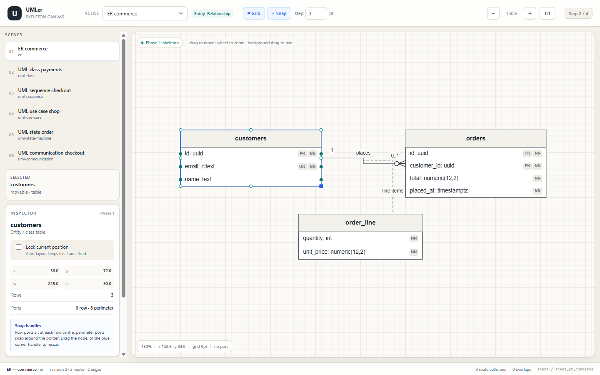

# 04 — Step 2: two-phase canvas core

**Status:** Step 2 complete; Step 3 builds the editor layer on top (see [05 — Step 3](05-step3-editor.md)).
The application shell, skeleton measurement pass, grid canvas, snap-handle calculator and live drag/resize loop
are implemented and verified in Chrome.



## 1. Stack decision

Step 2 uses **Vite 8 + React 19 + TypeScript 5.9**, with an SVG skeleton canvas.

- SVG gives crisp text, stroke widths and hit targets without a second canvas renderer.
- The DOM is used for the shell, inspector and accessibility; the diagram itself is SVG.
- No UI state library is needed yet. React state + `useMemo` around the layout pass is sufficient for the
  fixture scale (3–6 nodes); Step 3 can move the layout pass into a worker if required.

The Vite config is plain ESM and the dev/build scripts pass `--configLoader native`. Why: Vite's bundled
config loader spawns a helper process for realpath resolution, which the current Windows sandbox blocks with
`spawn EPERM`. The native loader is a supported Vite option and the build works normally outside that sandbox.

## 2. Implemented pipeline

```text
SceneDocument
   │  (persisted semantic state + preview frames)
   ▼
withNodeFrames() ── drag/resize preview, no document mutation
   ▼
buildLayoutSnapshot(scene, textMeasurer)       Phase 1
   ├─ CanvasTextMeasurer (Arial, cached)
   ├─ table bands / shape frames / lifeline spine
   ├─ row + perimeter + spine ports
   ├─ edge attachment resolution (incl. edge-to-edge)
   ├─ simple orthogonal route
   ├─ label frames + tether geometry
   ├─ content/export bounds
   └─ diagnostics (overlaps, route collisions)
   ▼
LayoutSnapshot
   ├─ SVG skeleton (nodes, edges, labels, port handles)
   └─ Phase 2 input for the Step 4 Typst/CeTZ serializer
```

Phase 2 (Typst/CeTZ serialization and WASM-rendered SVG preview) is implemented in Step 4. The serializer
consumes the same `LayoutSnapshot`; the preview hook discards stale results with a version guard (see
[06 — Step 4](06-step4-export.md)).

## 3. Layout / measurement pass

`src/layout/build-layout.ts` implements:

- **Table bands.** Header height, row height distribution across sections, text truncation, constraint badges.
  Class headers with a stereotype are measured as one title + stereotype stack, explicitly centred in the header.
- **Class/entity rows.** Visibility/custom prefix + name + type + constraints; method parameter and return
  formatting through `formatRow`.
- **Shape nodes.** Actor silhouette geometry, use-case ellipses, state rounded rectangles, object boxes,
  pseudo-states, ER diamonds, system/interaction frames and image placeholders/captions.
- **Lifelines.** Head frame, dashed spine, activation bars, destruction marker and spine ports.
- **Ports.** Row west/east at exact row centers; eight perimeter compass ports; arbitrary angle resolution;
  lifeline `spine(t)` resolution; activation top/bottom anchors.
- **Attachments.** Node port lookup, edge-to-edge path anchors (`t ∈ [0,1]`), free points. Edges are resolved
  in dependency passes so an edge can attach to another edge without recursion.
- **Routing.** Straight and polyline routes; a deterministic orthogonal preview with source/target stubs,
  midpoints and collinear-point simplification. If the basic route doubles back under its own source/target
  node, it takes a corridor outside that frame instead. Step 3 replaces this preview with the sparse A* router.
- **Labels.** Three zones, explicit offset, frame measurement, nearest-border tether. Labels are a separate
  render layer above nodes, so long state/transition labels are not clipped by state fills. A label that would
  intersect a table/class/shape frame is stepped away from the edge (preserving the requested side when
  possible) and re-tethered. Step 3 extends this to label-label collision.

`src/layout/text.ts` provides the browser `CanvasTextMeasurer` and a deterministic `FixedTextMeasurer` for
Node tests. The layout pass caches measurements by `(text, style, maxWidth)`.

## 4. Canvas core

`src/canvas/CanvasStage.tsx` owns:

- infinite screen-space SVG grid;
- camera `{x,y}` + zoom;
- screen ↔ world conversion;
- pan (right-button or middle-button drag), wheel zoom about the cursor and fit;
- node drag, resize handle and commit;
- live port hover / nearest-port readout;
- snap guides;
- text remains visible during drag/resize;

### Camera math

- `world = (screen - camera) / zoom`
- `screen = world * zoom + camera`
- wheel zoom preserves the world point under the cursor;
- fit clamps to a 150% ceiling so a small diagram is not blown up to 250% on a large monitor.
- fit uses `LayoutSnapshot.fitBounds`, which excludes decorative lifeline tails. Sequence fitting therefore
  stops at the last message/activation instead of reserving empty space down to the bottom of every lifeline.
  `contentBounds` / `exportBounds` still include the full drawn lifelines.

### Grid

The grid is a screen-space SVG pattern. It remains visually infinite because the pattern offsets are
`camera mod (gridSize * zoom)`. Minor lines are suppressed when their screen spacing falls below 4 px; major
lines continue every `majorEvery` cells. Grid size is configurable from 3–72 pt.

### Snapping

`src/layout/snap.ts` implements:

- grid snapping for moved nodes and resized edges;
- alignment guides against other nodes' left/center/right and top/middle/bottom lines;
- a one-cell minimum size on resize;
- `snapHandlesForNode` and `nearestPort` for port hit-testing;
- screen/world conversion helpers.

Snapping is applied to **frames and waypoints**, not to row ports. Row ports remain at their row centers.

### Interaction model

- Left-drag a node: transient frame preview; grid + alignment snap; text stays visible; commit on pointer-up.
- Drag the blue corner handle: snapped width/height; minimum one cell.
- Right-drag or middle-drag anywhere on the canvas: camera translation. Starting over a node is allowed and
  does not select it or change the revision.
- Left-click empty canvas: clear selection. Left-drag empty canvas is reserved for marquee selection.
- Wheel: zoom at the cursor.
- Click a node: selection, row/perimeter handles and inspector.
- Lock: `locked` is preserved as a layout constraint; drag still updates the current fixed frame.
- Revision increments only on commit, so a future Typst result can be matched to the current document.

## 5. Rendering / layering

- **Edge lines + endpoint glyphs** are below nodes for class/ER/state/use-case/communication.
- **Edge labels** are above nodes, which prevents table/state fills from clipping long labels.
- **Sequence diagrams** render messages above lifelines/activation bars; sync messages use a filled arrow,
  replies a dashed open arrow, so the notation survives the skeleton pass.
- **Port handles** are above nodes and edges; radius is divided by zoom to stay screen-constant.
- **System boundary frames** are transparent, so include/extend/association lines inside a use-case boundary
  are not hidden.
- **Text visibility** is kept during drag/resize. Hiding row/shape text on pointer-down caused flicker and broke
  canvas text double-click editing; frame bands, headers and ports remain visible alongside the text.
- **Table borders** draw their fills first and the outer stroke last. Drawing the header fill over the stroke
  made the header border look thinner than the body border; the stroke-last order keeps the border uniform.

## 6. Verification

### Automated

```text
npm run check
  typecheck: pass
  validate:scene: 6 fixtures, 0 errors, 0 warnings
  test:layout: pass
    fixtures: 6
    ER nodes/ports/edges: 3/42/2
    row ports align to frame borders and row centers
    perimeter ports are on the frame border
    edge-to-edge tether resolves to the parent edge midpoint
    grid/alignment snapping and resize rounding
    preview frames re-layout without mutating the document
```

`npm run build` passes from a clean `tsc --noEmit` and produces `dist/`.

### Browser verification (Chrome DevTools MCP)

- Loaded all six fixtures.
- Selected the `customers` table: 6 row handles + 8 perimeter handles.
- Dragged it 27 × 18 pt: committed frame `63,90` with grid snapping and revision bump.
- Resized it through the corner handle: `252 × 108`, revision bump.
- Verified the relation-attribute edge detours around its table, the label clears the table and re-tethers, and
  the ER fixture reports 0 route collisions.
- Verified sequence fit uses `fitBounds` (468 × 381) rather than the 468 × 630 full lifeline extent, so the
  last message stays near the viewport bottom with no reserved empty band.
- Checked sequence arrowheads (sync/reply), use-case include/extend direction, state transitions and
  communication numbering.
- Console is clean except for optional React DevTools messaging.

The screenshot at the top of this document is the actual running app at 1440 × 900.

## 7. Known limits at the Step 2 boundary

- The Step 2 route preview was not globally obstacle-avoiding. Step 3 added A* routing, edge selection,
  endpoint popovers, label collision and layered auto-layout; see [05](05-step3-editor.md).
- Framed/container-aware auto-layout and sequence lane editing remain deferred.
- Label dragging/pinning, multiline/wrapped labels and live CeTZ glyph previews remain deferred.
- Actor ports follow the frame rectangle; silhouette clipping is a UI decision left open.
- Phase 2 Typst/CeTZ serialization and live SVG preview were added in Step 4; PDF/SVG file export remains
  deferred.
- Undo/redo, persistence and multi-user sync are outside the four requested steps.

## 8. Run it

```bash
npm install
npm run dev        # http://127.0.0.1:5173/
npm run check
npm run build
```

If the Typst proof sheet is needed:

```bash
npm run bootstrap:typst
npm run proof
```
