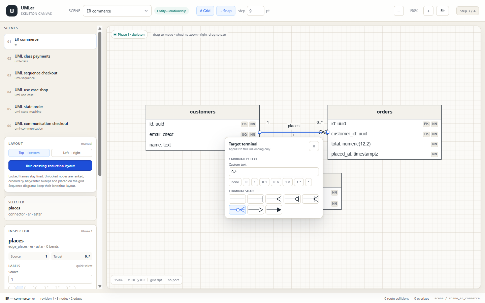
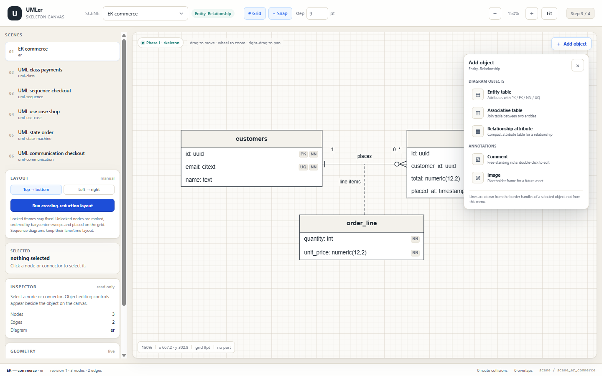
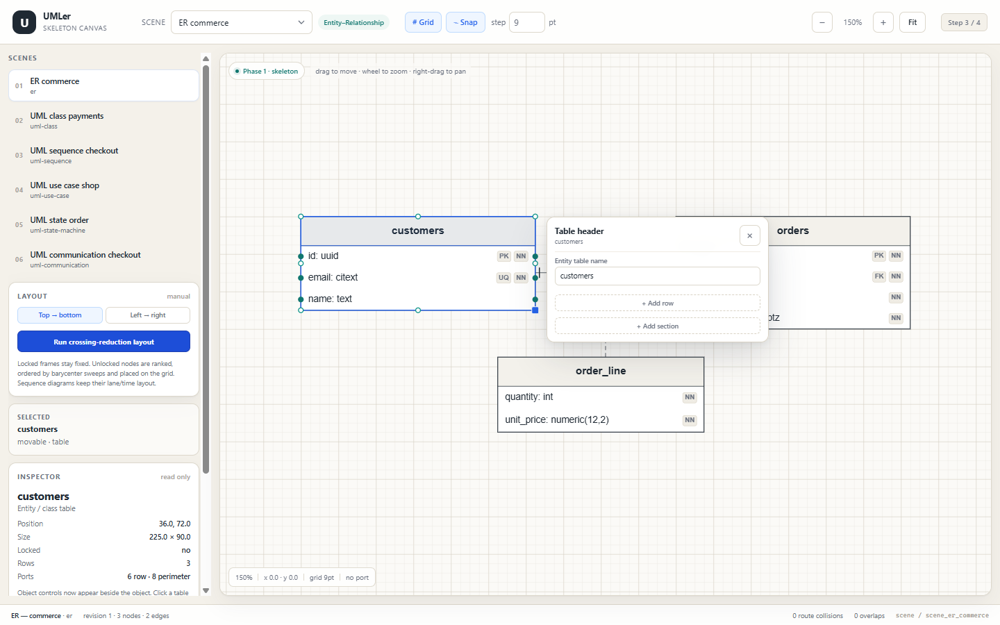
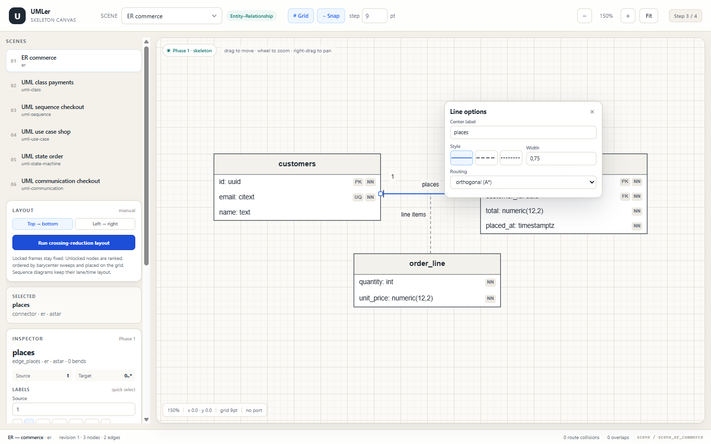

# 05 — Step 3: editing, routing and auto-layout

**Status:** Step 3 complete. The editor now has a diagram-aware object palette, port-drag connector creation,
selectable connectors, endpoint marker menus, table content editing, label quick-select/collision avoidance,
a sparse orthogonal A* router, and a layered crossing-reduction layout with lock constraints.



## 1. What is editable

### Application menu, scenes and panel

The top bar is the only scene switcher. Its **File** menu exports and imports scene and project JSON files.
The **Scene** menu provides:

- **New scene…** — dialog with six square diagram-type icon buttons (ER, class, use case, sequence,
  communication, state), a **Template / Empty** start choice (Template is the default and uses that type’s
  built-in example), and a scene name. Until the name is edited, choosing a type updates it to
  `Untitled <diagram type> diagram`. Template copies the built-in diagram; Empty creates a blank scene;
- **Rename scene…** — dialog editing the active scene title;
- **Duplicate scene** — clones the active document with a unique ` (2)`, ` (3)`, … suffix;
- **Delete this scene…** — warning dialog; disabled when only one scene remains.

Scene operations reset the undo history after switching/creating/deleting and fit the canvas to the new scene.
The layout panel can be hidden with the **Panel** toolbar toggle; the workspace then becomes a single canvas
column and the canvas refits to the larger area.

### Scene and project files

The **File** menu has four actions:

- **Export scene…** downloads the active scene as `<scene title>.scene.json`. The wrapped document contains a
  format marker, version, export timestamp and one `SceneDocument`.
- **Import scene…** validates the chosen JSON and adds it as a new scene, so it never overwrites the current
  project. A new scene id is allocated and a duplicate title gets the same ` (2)`, ` (3)`, … suffix as
  duplication. The imported scene becomes active.
- **Export project…** downloads `umler-project.json` with every scene and the active scene id.
- **Import project…** validates all scenes, asks for confirmation, replaces the in-session project with the
  file’s scenes and restores its active scene. It is a project open, not a merge.

Both formats carry a top-level `format`/`version` envelope. Scene imports also accept a bare
`umler.scene/1` document, which keeps the existing `examples/*.json` files usable. Import runs
`validateScene`; any structural errors reject the file before it reaches the canvas. Unknown versions and
duplicate project scene ids are rejected. Project imports reset the undo history to the active imported scene.

Image assets are exported as metadata records only; binary image bytes and the real asset store are Step 4.

### Adding objects

Two entry points open the same catalogue:

- the **+ Add object** button in the canvas top-right opens it under the button;
- **single right-click on empty canvas space** opens it at the pointer. Right-drag still pans; a right-drag
  never opens the catalogue. Right-clicking an object or connector is consumed and does not add anything.



The catalogue is filtered by `scene.meta.diagramKind`:

| Diagram | Diagram objects |
|---|---|
| ER | Entity table, associative table, relationship attribute |
| UML class | Class |
| UML use case | Actor, use case, system boundary |
| UML sequence | Lifeline, interaction frame |
| UML communication | Communication object |
| UML state machine | State, initial state, final state, choice |
| **Every diagram** | **Comment, Image** |

Comments and images are annotations, shown in a separate group. Connectors are deliberately **not** in the
menu: they are drawn by dragging from the border, row or spine handles of a selected object. Dropping on a
different object creates an edge whose semantic family and default terminals match the diagram type.

New objects are grid-aligned, placed near the requested point without overlapping an existing object, selected
immediately and given their floating focus menu. A new sequence lifeline is added as a new lane to the right of
the existing lanes, aligned with their heads. Images get a placeholder asset record until Step 4 replaces it
with the real asset pipeline.

### Floating object focus menus

Object properties are no longer edited in the side inspector. The side inspector is read-only; editing controls
appear beside the focused object, like the connector menus.



Focus granularity for tables/classes:

- **Table header focus** — first click a header. Controls: entity/table name, class stereotype (classes),
  Add row, Add section. Double-clicking the header starts editing the table name.
- **Section focus** — first click a section (header, empty section area, or the top border/divider line above
  its rows). Controls: section header text, Add row, Add section, Remove this section. A second click on that
  section's header focuses the header input. The divider above the rows is a dedicated hit strip, so an
  untitled section remains selectable even when its header text is empty.
- **Row focus** — click anywhere in a row. Controls: attribute/operation name, data type or return type,
  `PK`/`FK`/`NN`/`UQ` toggles, Add row, Delete row. Double-clicking the name or type text focuses that field.

Other diagram objects get an object focus menu with their displayed text field: actor/use-case/state/object/
relationship/frame name, lifeline head label, image caption, or a multi-line comment body. Shape bodies are
clickable so blank areas also focus the object. An empty lifeline head label is stored as an empty label and is
rendered blank; it does not fall back to the node name. Header and object menus have a **Delete object** action,
which also removes every connector attached to that object.

### Undo / redo

The editor keeps a 100-entry snapshot history of the immutable `SceneDocument`. Every committed scene edit is
one history step; rapid text edits within 350 ms are coalesced into one step. Undo/redo restores a snapshot,
bumps the revision and clears the transient selection/menus.

- Toolbar **Undo** / **Redo** buttons are disabled when their stack is empty.
- `Ctrl/Cmd+Z` undoes; `Ctrl/Cmd+Shift+Z` or `Ctrl+Y` redoes.
- Shortcuts are ignored while focus is in an input, textarea, select or content-editable field, preserving
  native text editing.
- Loading a scene from the top scene switcher resets the history.

**Lifelines are different:** only the head and the thin time-axis strip are interactive, not the whole lane
frame. This keeps the focus highlight to the head plus a thin axis line and lets arrows, interaction frames and
notes underneath receive clicks. Clicking the dashed axis opens a **lifeline menu** at that y with the head
label, **+ Add activation bar here**, and **Delete lifeline**.

- **Activation** creates the tall execution-specification box directly on the clicked lifeline, centred on the
  cursor y (default height 90 pt, clamped to the lifeline frame). This is the box drawn over the dashed axis.
  Its connection handles are generated automatically and spaced evenly along the bar (about one handle every
  54 pt, capped at 3–7 handles including the two ends). Generic 25/50/75% spine handles are only used when the
  lifeline has no activation bars, so the visible handles always follow the bar being edited.
- An activation bar can be **moved vertically** by dragging the bar itself, and **resized vertically** with the
  top/bottom square handles shown when it is selected. Grid snapping applies; limits are the lifeline frame.
- Hover feedback follows the action: the bar body shows a move cursor, the top/bottom border bands show a
  vertical-resize cursor, and those border bands can start a resize directly. While a bar is selected its
  evenly spaced connection handles stay visible over it; the square resize handles sit just outside the bar ends
  so they do not cover the connection ports.
- The blue selected-lifeline axis is drawn in segments and is hidden underneath activation bars, so the bar
  interior stays visually clean.
- Interaction frames remain available from the **+ Add object** palette, but the lifeline axis menu no longer
  creates one. Frames hit-test on their border strips and title, not their whole interior, so messages and
  arrows inside a frame remain selectable.

### Delete key

`Delete` / `Backspace` applies the least destructive removal for the current focus, unless focus is in an input,
textarea, select or content-editable element:

1. focused **section** → delete that section (for a table);
2. focused **row** → delete that row;
3. selected **activation bar** → delete that activation only;
4. selected **connector** → delete the connector;
5. selected **object** → delete the object and all attached connectors.

Pressing Delete once on a section therefore leaves the table header intact; pressing it again with the table
selected removes the table. Deleting a connector also removes connectors attached to it.

Every edit goes through a pure `SceneDocument` helper in `src/model/edits.ts`, increments the revision once,
and re-runs the same Phase 1 measurement pass. Frame geometry is persisted separately; row bands, ports,
headers and badges are always derived.

### Connectors

Dragging from a selected object's border/row/spine handle draws a connector. Releasing over another object
creates it with the diagram's default family: ER one-to-many, UML association, sequence sync message,
communication forward message, or state transition. The source port is preserved exactly; a drop on the target
body resolves to the nearest perimeter port (or the exact spine point for a lifeline). Dropping on an existing
line creates an edge-to-edge attachment — this is how a relationship-attribute table is tethered to a
relationship — with a dashed, marker-free anchor line. If no target is under the pointer the draft is discarded.
The new connector is selected so its line/terminal menus can refine it.

Clicking a connector selects it and exposes:

- its semantic name, route type and bend count;
- source / center / target label editors with cardinality quick-select chips;
- stroke pattern (`solid`, `dashed`, `dotted`);
- routing mode (`orthogonal`, `straight`); sequence messages show a fixed-straight note instead;
- a **Re-route with A\*** action.

Selecting a connector also shows square endpoint handles on the canvas. **Dragging either endpoint handle**
onto another object reattaches that source or target, preserving the opposite end. The drop resolves through the
same port logic as drawing a new connector: nearest row/perimeter port, an exact spine point on a lifeline, or
an edge-to-edge attachment when dropped on another line. A preview line and snap marker are shown while
dragging, and the 5° axis snap/Alt bypass applies. A click without dragging still opens the terminal menu.

Clicking an endpoint handle, the terminal glyph itself, or its cardinality label opens a compact terminal menu
for **that end only**. Terminal and line hit layers are painted **below nodes**, so clicking inside an entity
always selects the entity; only the part of the endpoint hit region outside the object opens the terminal menu.
The terminal menu contains:

- a small free-text cardinality input;
- `none` first, followed by suggested chips (`0`, `1`, `0..1`, `0..n`, `1..n`, `1..*`, `*`);
- terminal glyphs relevant to the diagram family (ER crow’s feet or UML triangles/diamonds/arrows) plus
  generic open/filled arrows;
- `No terminal (plain line)` first in the glyph row.

Dashed UML marker variants (realization/dependency) are omitted from the glyph menu: dash is now a line-style
setting, not a separate terminal choice. The terminal menu is positioned outside the line and away from the
endpoint label so it does not cover its own terminal.

The global line options are a separate popover, opened by clicking the line away from its terminals or the
centre label. It contains only the **center label**, a consistently labelled **Style** row with visual
full/dashed/dotted previews, **Width** on the same row, and **Routing** (**orthogonal (A\*)** or straight).
Polyline/bezier modes were removed from the UI because they had no working implementation.

**Sequence messages are always straight.** Their line menu shows a note instead of the routing selector, the
endpoint handles use the time axis directly, and the layout pass ignores any legacy orthogonal flag on a
sequence edge. This prevents A\* detours from turning a message into a staircase.

While drawing a connector, a target on a lifeline spine snaps to the source's horizontal axis when the raw
angle is within **5°** of horizontal (0°/180°). The snap is disabled while **Alt** is held. Sequence messages
therefore land on an exact horizontal message row even when the pointer is slightly high or low.

**Sequence messages can be moved vertically.** Drag the line itself (away from its endpoint handles): both
spine anchors move by the same grid-snapped delta, so the message stays horizontal. The original edge is hidden
during the drag and replaced by a live preview; releasing commits the new time-axis position. A click without
dragging still opens the line menu. The endpoint handles can independently reattach either end to another
lifeline, so a message can both change lanes and change its time position.



ER terminal geometry is padded from the entity border: the `one` bar sits inside the connector, the
`oneOrMany` bar sits behind the crow’s-foot apex, and `zeroOrOne` places the circle next to the entity with its
bar behind the circle. Open-angle arrowheads keep the connector running to the vertex; closed/filled/hollow
terminals stop at the glyph base.

Mixed endpoints are first-class: a crow’s foot on the source and a cardinality label on the target are just
two independent endpoint records in `markers` + `labels`. Visible connector geometry is shortened at terminal
glyphs, so a crow’s-foot fork or an arrow does not have the line drawn through it to the entity border.

## 2. Sparse orthogonal A* router

`src/layout/router.ts` implements a deterministic orthogonal router on a **Hanan grid**:

- obstacle frames are inflated by `routing.obstaclePadding`;
- candidate x/y coordinates come from the start/end points and every obstacle edge;
- path states are `(point, arrivalDirection)`, so a 90° turn adds an explicit bend penalty;
- Manhattan distance is the A* heuristic;
- source/target stubs are included in the returned polyline;
- the result is validated against all solid node frames before acceptance.

Perimeter ports that are not tied to a specific row are **dynamic**. The layout pass evaluates the four sides
of the node, slides the anchor along the chosen side toward the partner, keeps it at least one grid square from
corners, and reserves grid-spaced anchors when several lines share a side. Dynamic anchors are chosen jointly
for the source/target pair with a shortest-path score that also penalizes lines leaving a node backwards.

**Elliptical nodes keep their true ellipse anchor.** Use-case drops resolve an angle port at the exact ellipse
border rather than one of the eight compass points, and the dynamic rectangular slide is skipped for use cases.
The chosen angle faces the **fixed partner endpoint**, not the pointer position: dropping anywhere on the
ellipse attaches to the curve on the side facing the other end. Reattaching a line to an ellipse therefore ends
on the curve, never on the invisible bounding rectangle and never on the far side through the ellipse.

Auto-layout marks the angle as automatic. Automatic ellipse anchors are re-evaluated on **every layout pass**,
so moving the actor or partner manually immediately moves the arrow to the facing side. A manually dropped
anchor is not marked automatic and keeps the exact curve point the user chose.

Ellipse routing stubs are snapped to the dominant axis before A\* runs. The visible endpoint remains exactly on
the curve, but the final connector segment is horizontal or vertical instead of a diagonal normal stub, which
removes the small V/spike where an orthogonal route met the ellipse.

When A* and the simple orthogonal preview have equivalent length, the preview with fewer bends wins. This
avoids the equal-cost “staircase” routes A* can produce when several grid lines align.

`src/layout/build-layout.ts` applies the router when `routing.mode === "orthogonal"` and
`routing.avoidObstacles === true`. If A* fails validation, the endpoint-aware orthogonal preview is used as a
fallback; the edge is never deleted or hidden.

Double-clicking an edge sets orthogonal routing + obstacle avoidance and reruns the route. The line popover
and inspector both have a **Re-route with A\*** button. Neither action changes a sequence message: its layout is
forced to straight time-axis routing.

Frames and lifelines are not routing obstacles: frames are containers and lifelines are structural axes in the
skeleton.

## 3. Layered auto-layout

`src/layout/auto-layout.ts` is a compact Sugiyama-style pipeline:

1. collect semantic edges between layoutable nodes (frames and lifelines excluded);
2. break cycles by dropping DFS back edges from the rank graph;
3. rank nodes by longest path;
4. sort layers by current position, then run forward/backward barycenter sweeps;
5. assign TB or LR coordinates rank by rank, preserving node sizes;
6. keep locked frames exactly where they are and treat them as placement obstacles;
7. snap unlocked positions to the document grid;
8. return the frame map; the caller commits one revision.

The layout panel reports moved nodes, layer count and approximate crossings before/after. The synthetic
two-layer test in `scripts/test-layout.ts` starts with one crossing and ends with zero.

### Use-case system boundaries

- A use case **fully enclosed** by a system-boundary frame is a derived child of that boundary. Partial
  overlap is not enough; the entire use-case frame must sit inside the boundary.
- Moving the boundary drags all enclosed use cases by the same delta in one revision, preserving their internal
  arrangement. The boundary border is the hit target, so the use cases themselves stay individually editable.
- Auto-layout treats the boundary as **one layout unit**: enclosed use cases are removed from the top-level
  graph, external edges are remapped to the boundary, and edges internal to the boundary are ignored. After the
  boundary is placed, its children keep their original relative offsets.
- When the layout finishes, every edge endpoint on a use-case ellipse is re-anchored to a **favourable angle
  toward the partner's new centre**. This happens in the same revision as the frame commit, so the arrow moves
  from its old spot to the newly facing ellipse border instead of staying fixed.
- External association lines still terminate on their use cases and visually cross the system boundary; the
  boundary is the layout-level connectivity proxy, not a replacement target.

### Scope / guards

- **Sequence diagrams:** skipped; lane/time layout must not reorder messages.
- **Framed diagrams** other than use-case system boundaries (interaction frame, package): skipped for now.
  The container must stay fixed, and moving its children without a container-aware coordinate pass would break
  the diagram. The UI explains this instead of producing a broken result.
- A fully locked diagram is a no-op with an explanatory note.
- Manual drag remains available on locked nodes; lock only excludes automatic movement.

## 4. Labels

- Labels render above edges and nodes.
- Endpoint labels are anchored outside the entity border along the connector direction, with the label centre
  stepped by half its measured width. Deleting and re-adding a cardinality value therefore places it back near
  the endpoint rather than searching far around the diagram.
- No dashed leader/tether is rendered for ordinary relationship labels. Only the relation-attribute connector
  itself stays dashed.
- A label that intersects a table/class/shape frame is stepped outward, keeping the requested side when
  possible.
- Endpoint terminal glyphs and the edge line itself are clearance obstacles; cardinality labels no longer sit
  on top of crow’s feet, arrows or the connector.
- After each label is placed, its frame is added to the label obstacle list, so later labels avoid earlier
  labels (deterministic label-label collision resolution).
- Double-clicking a cardinality label opens its terminal menu and focuses/selects the custom-text field.
- Double-clicking the centre label opens the line menu and focuses/selects the centre-label field.
- Clicking the centre label once also opens the line menu beside it, without covering it.
- Quick-select chips replace the current endpoint cardinality text; the terminal menu also has a free-text
  field for custom values.
- Relation-attribute labels must not overlap their attribute table; the relation-attribute route uses dynamic
  perimeter anchors.
- **Labels can be dragged directly.** Dragging a centre or endpoint label stores a manual offset relative to
  its resolved edge anchor and marks the label pinned. Pinned labels bypass automatic endpoint conventions and
  collision nudging, so they stay exactly where released (possibly overlapping by user choice). A click without
  dragging still opens the line/terminal menu, and double-click still focuses the text field.

## 5. Canvas text double-click

Every primary text on the SVG canvas is a double-click target. The canvas emits a semantic
`CanvasTextTarget` (see `src/model/text-targets.ts`), the node/edge is selected, the matching floating menu is
opened, and its input is focused and selected:

| Canvas text | Field |
|---|---|
| table / class / relation-attribute header | table name |
| `«stereotype»` | class stereotype |
| section header | section title |
| attribute / operation name | row name |
| data type / method return type | row type |
| constraint badge (`PK`, `FK`, `NN`, `UQ`) | that row’s name field |
| actor, use case, state, object, relationship, frame text | node name |
| lifeline head label | lifeline head label |
| image caption and `IMAGE` placeholder | caption |
| comment line | comment body (multi-line textarea) |
| edge center / cardinality labels | line menu / terminal menu with focused field |

Focus requests carry a monotonic token, so double-clicking the same text repeatedly re-focuses and re-selects
the input. The floating menu is kept beside the object and scrolls the target field into view. Canvas text stays
mounted during pointer-down, drag and resize; the earlier skeleton mode hid row/shape text on mouse-down,
which caused flicker and made the second click of a double-click miss the text target. Node pointer capture is
deferred until the pointer moves more than 3 px, so the native double-click target remains the text instead of
the SVG capture layer. Focus is applied after the selection/menu update and uses `setSelectionRange` so the
existing text is visibly selected.

## 6. Files

| File | Purpose |
|---|---|
| `src/app/use-scene-history.ts` | Bounded snapshot undo/redo with typing coalescing |
| `src/model/persistence.ts` | Scene/project envelopes, strict import validation and download names |
| `src/app/file-transfer.ts` | Browser download and text-file helpers |
| `src/app/ProjectImportDialog.tsx` | Destructive project-import confirmation |
| `scripts/test-persistence.ts` | Scene/project round-trip and rejection tests |
| `src/app/AppMenuBar.tsx` | File / Scene application menus |
| `src/app/SceneDialog.tsx` | New / rename / delete scene dialogs |
| `src/model/containment.ts` | Derived use-case/system-boundary containment |
| `src/model/object-catalog.ts` | Diagram-aware palette, placement search and object factories |
| `src/model/edge-create.ts` | Connector factory for port-drag creation (family defaults) |
| `src/canvas/AddObjectMenu.tsx` | Shared add-object menu for the button and right-click |
| `src/layout/router.ts` | Sparse orthogonal A* with bend penalty and fallback result |
| `src/layout/auto-layout.ts` | Cycle break, ranks, barycenter ordering, lock-aware coordinates |
| `src/model/edits.ts` | Pure, revision-incrementing scene edits (rows, labels, markers, routing) |
| `src/canvas/EdgeEndpointPopover.tsx` | Compact per-end cardinality/terminal menu |
| `src/canvas/MarkerIcon.tsx` | SVG glyph previews for the terminal menu |
| `src/canvas/CanvasStage.tsx` | Edge hit layer, endpoint handles, line/terminal popovers, A* double-click |
| `src/canvas/Edges.tsx` | Glyph rendering and line shortening at terminal glyphs |
| `src/model/node-focus.ts` | Table/section/row/object focus granularity |
| `src/canvas/NodeFocusMenu.tsx` | Floating table, section, row and object control menu |
| `src/model/text-targets.ts` | Semantic canvas-text targets + focus-request token |
| `src/canvas/NodeSkeleton.tsx` | SVG text rendering and double-click target mapping |
| `src/app/EdgeInspector.tsx` | Connector labels, route mode, stroke and reroute; reused as the line popover |
| `src/app/LayoutPanel.tsx` | Direction choice, auto-layout action, result note |
| `src/app/Inspector.tsx` | Read-only selection/geometry inspector |

## 7. Verification

```text
npm run check
  typecheck: pass
  validate:scene: 6 fixtures / 0 errors / 0 warnings
  test:layout: OK
    A* route assertions
    relation-attribute route/label clearance
    label-node + label-label collision assertions
    sequence fit-bounds assertion
    locked-node auto-layout assertion
    synthetic crossing reduction 1 → 0
    LR communication reverse edges separated by one grid step
  test:persistence: 29 assertions
    scene + bare-scene + BOM round trips
    project round trip and active-scene fallback
    malformed/duplicate/invalid imports rejected
```

`npm run build` passes.

Browser checks:

- edit table name/rows; revision increments and derived bands re-measure;
- click a table header, section and row; confirm the correct floating menu appears beside the object and the
  side inspector stays read-only;
- double-click table header, section header, row name, data type, constraint badge and other object text;
  confirm the matching field is focused and selected;
- add a table row from the floating menu and confirm the table/revision update;
- open **+ Add object** and confirm the catalogue matches the active diagram (ER / class / use case /
  sequence / communication / state), with Comment and Image in every catalogue;
- right-click empty canvas space and confirm the same catalogue opens at the pointer; right-drag to pan and
  confirm no catalogue opens on release; right-click a node and confirm no catalogue opens;
- add an entity table, state, communication object and lifeline; confirm each is selected, placed on-screen and
  opens its floating focus menu;
- add a comment, enter two lines and resize it; confirm the note renders both lines and truncates overflow;
- add an image and edit its caption; confirm the placeholder frame and caption frame update together;
- drag from a selected object's port to another object and confirm a connector is created with the diagram's
  defaults; drag to empty space and confirm no connector is created;
- drag from a relationship-attribute table to an existing relationship line and confirm a dashed,
  marker-free edge-to-edge attachment appears (including when the target line is itself edge-to-edge);
- in a sequence diagram, click an arrow beside a lifeline and confirm it selects even though the lane frame
  extends underneath; confirm the lifeline highlight is only its head + thin axis;
- click the dashed lifeline axis, use **+ Add activation bar here**, and confirm the tall execution box appears
  on that lane centred on the clicked height, with connection handles evenly spaced along the bar;
- drag an activation bar up/down and resize it from both end handles; confirm it snaps to the grid and stays
  inside the lifeline; press Delete with the bar selected and confirm only that activation is removed;
- while the activation is focused, confirm its connection handles remain visible over the bar and that the blue
  selected axis is not drawn under the bar; hover the body and the top/bottom bands to confirm move vs resize
  cursors;
- right-/middle-drag pan, release, then click a node/edge and open another scene tab; confirm pan mode ends and
  normal selection works;
- confirm the lifeline axis menu no longer offers an interaction frame (the frame remains in the Add object
  palette);
- confirm a sequence edge shows no orthogonal routing control and stays straight even after double-clicking it;
- draw from a sequence port to a lifeline body at a slightly different height and confirm the message snaps
  horizontal within 5°; hold Alt and confirm the unsnapped height is used;
- select a connector, drag its source handle to a different entity and confirm only the source changes; repeat
  with the target handle; click either handle without moving and confirm the terminal menu still opens;
- drag a sequence message line up/down and confirm both ends move by the same grid-snapped amount and the line
  remains horizontal; click the line without dragging and confirm the line menu opens;
- reattach a line to a use-case ellipse at a diagonal and confirm the endpoint lies on the ellipse, not the
  bounding rectangle; drop on the far side and confirm it chooses the curve side facing the partner;
- drag a centre label and an endpoint label; confirm they follow the pointer, keep the manual offset after an
  unrelated layout/route change, and still open their menus when clicked without dragging;
- drag a system boundary by its border and confirm all enclosed use cases move by the same delta while the
  actor/image do not; run auto-layout and confirm the boundary is placed as one unit and child offsets survive;
- run auto-layout on a use-case diagram with an actor association and confirm the arrow re-anchors to the
  ellipse edge facing the actor, rather than remaining at its previous angle;
- after auto-layout, drag the actor below the use case and confirm the automatic arrow moves to the ellipse’s
  lower side without running layout again; confirm every segment of the resulting route is horizontal or
  vertical and no diagonal V/spike appears at the ellipse;
- press Delete on a focused section and confirm only the section disappears; press it again and confirm the
  table is removed; repeat for a row and for a connector;
- add an object, undo it, redo it; confirm the toolbar buttons enable/disable correctly and `Ctrl+Z` works when
  the canvas has focus but is left to the native editor inside a text field;
- clear a lifeline head label, blur the field and confirm the render stays empty rather than reverting to the
  node name; undo restores the previous label;
- create a scene from the Scene menu using the square type icons; confirm the default name updates to
  `Untitled <type> diagram` until edited, Template starts from the built-in example and Empty has 0 nodes;
  duplicate (unique number suffix), rename, delete through the warning dialog, and confirm the top-bar scene
  switcher follows each change;
- use File → Export scene / Import scene and confirm the scene round-trips and imports under a unique title;
  use File → Export project / Import project and confirm all scenes and the active scene are restored, then
  import broken JSON and confirm the error toast;
- hide and restore the layout panel and confirm the canvas widens/refits;
- click a terminal glyph and its cardinality label; both open the terminal-only menu;
- click the line away from its ends; the line-only menu opens with center label, line type, width and routing;
- confirm the terminal menu is placed outside the terminal/line and includes a custom-text field;
- apply ER crow’s-foot and generic terminals; confirm the visible line stops at the glyph, and that no dashed
  label leader is drawn;
- change line width and confirm the rendered stroke changes;
- quick-select cardinality chips in the line menu;
- double-click an edge to rerun A*;
- run TB and LR layout; verify the communication reverse edges no longer share a corridor;
- lock a node and verify its **world frame** is unchanged after auto-layout;
- verify sequence and framed-diagram auto-layout notes;
- confirm 0 route collisions and 0 label overlaps (including labels vs their own edge line) in all six fixtures.

## 8. Boundaries

- Framed/container-aware auto-layout and sequence lane editing are deferred.
- Label dragging/pinning and automatic word wrapping are deferred; current labels are moved by the collision
  pass. Comments support explicit newlines, with per-line truncation and a resizable frame.
- Terminal menus use SVG marker glyph previews; the CeTZ renderer’s own glyph preview remains Step 4.
- Autosave, recent-file history and embedding real image bytes in project files are deferred.
- Typst/CeTZ serialization and WASM compilation are Step 4.
