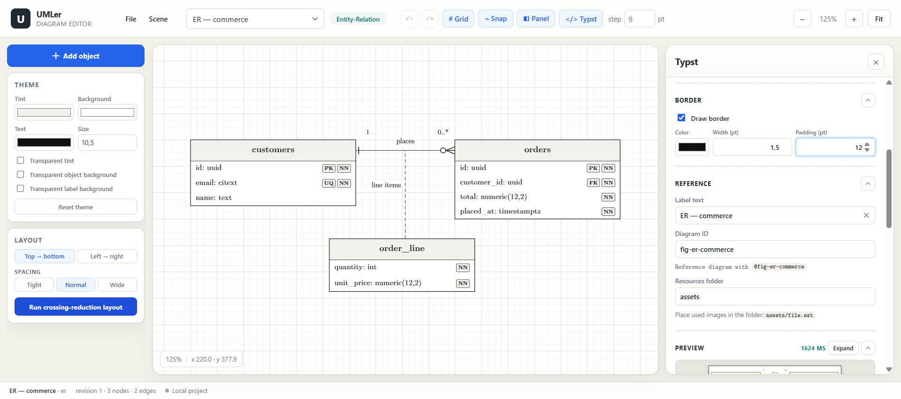
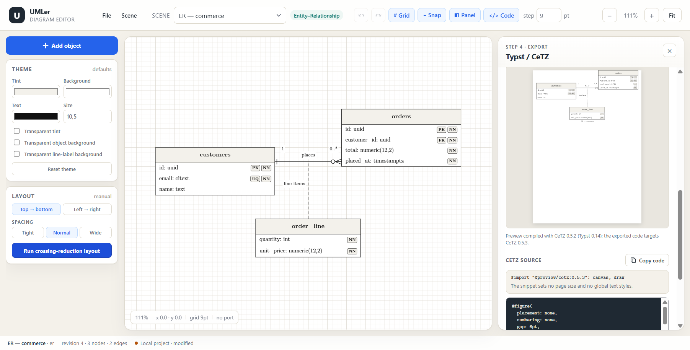

# 06 — Step 4: live Typst / CeTZ export

> **Checkpoint:** the right-side **Typst / CeTZ** panel generates a clean,
> human-readable **snippet** from the committed scene and renders it live in the
> browser through typst.ts. The snippet is pasted into an existing project: it
> contains no package import, no page setup and no global attribute setters. The
> host project is expected to import CeTZ's `canvas` and `draw` names
> (`#import "@preview/cetz:0.5.3": canvas, draw`, or `: *`). The in-browser
> preview compiles the same drawing calls against **CeTZ 0.5.2**, the newest
> CeTZ that runs under the Typst 0.14.2 engine embedded in typst.ts 0.7.0.





## 1. Visual conventions and their CeTZ vocabulary

The notation research and the full mapping live in
[00 — notation research](00-notation-research.md) and
[01 — CeTZ mapping](01-cetz-mapping.md). The Step 4 emitter uses this subset:

| Diagram | Visual convention | CeTZ primitives | Export notes |
|---|---|---|---|
| **ER** | Entity tables with PK/FK/NN/UQ badges; relationship lines with crow's-foot or text cardinalities; compact relation-attribute table tethered to a line | `group`, `rect`, `line`, `content`, `anchor`, `register-mark`, `mark` | Row ports are emitted as `row_<n>_west/east`; crow's feet are registered marks; the tether is a normal polyline because the router already resolved its points. |
| **UML class** | Compartmented class table, stereotype line, visibility prefixes, optional static/abstract markers | `rect`, `line`, `content`, `anchor` | The table is drawn as one outer `rect`, separator `line`s and absolutely positioned `content`. No Typst `table`/`grid` is used, so the row rhythm cannot drift from the layout snapshot. |
| **Use case** | Actor stick figure, use-case ellipses, system boundary, `«include»`/`«extend»` dashed arrows | `group`, `circle`, `line`, `content`, `rect`, `mark` | Ellipses use `circle(center, radius: (rx, ry))`; actors are explicit circles and strokes, never a font glyph. Boundaries are drawn before their children by z-order. |
| **Sequence** | Lifeline heads, dashed time axes, activation bars, straight sync/reply messages | `group`, `rect`, `line`, `content`, `anchor`, `mark` | Sequence messages are always emitted as explicit horizontal polylines. The canvas synthesizes reply/open and sync/filled arrowheads when the stored marker set is empty; the exporter applies the same rule. |
| **Communication** | Underlined object boxes and numbered association lines in both directions | `rect`, `line`, `content`, `mark` | The name underline is a separate `line`; reverse associations stay separate edges and separate corridors. |
| **State machine** | Rounded state rectangles, filled initial/final pseudostates, diamonds, transitions with `trigger [guard] / effect` labels | `rect`, `circle`, `line`, `content`, `mark` | `rect` radius is emitted in scene units; pseudostates are geometry, not symbols. |

`ortho` is deliberately **not** used: in CeTZ it is an orthographic 3D
projection, not orthogonal edge routing. Orthogonality is a property of the
resolved point list, which is emitted directly to `line`.

## 2. Pipeline

```text
SceneDocument + LayoutSnapshot
        │
        ├─ resolveExportSelection()   whole diagram or selected objects
        │      └─ one bounding box including nodes, edges and labels
        ├─ fitDiagramToPage()         requested zoom + fit-down only
        ├─ projectorFor()             origin shift, fit scale, y-down → y-up
        ├─ serializeSceneToCetz()     Typst/CeTZ text + preview variant
        └─ renderTypstPreview()       typst.ts → one-page SVG
```

The serializer is pure: no DOM, no camera, no re-routing and no re-measurement.
It reads the same `LayoutSnapshot` the SVG skeleton draws. The only geometry
operations are the selection origin, the page-fit scale and the y flip.

The user-selected page dimensions and per-side margins are **only inputs to the fit calculation**.
They are never written into the snippet. The preview is a disposable host
document that supplies the CeTZ import and a page of those dimensions; neither
line appears in the copied code.

## 3. Page fitting contract

Scene units are Typst points. The natural diagram size is the export selection
bounds, including the scene's `canvas.exportPadding`. The chosen page size is a
calculation input only; the snippet does not set a page.

```text
availableWidth  = pageWidth - marginLeft - marginRight
availableHeight = pageHeight - marginTop - marginBottom - captionReserve
fitLimit = min(availableWidth / naturalWidth,
               availableHeight / naturalHeight)
scale    = min(requestedDocumentZoom, fitLimit)
```

- At **100%** the diagram is never stretched merely because the page is larger.
- A user zoom above 100% is explicit and is honoured until the fit limit.
- The zoom value is a single number field (10–300%); it is typed directly.
- If the diagram does not fit the host's **content box**, it is reduced with the
  aspect ratio preserved.
- Page margins are per-side (top/right/bottom/left) and use the page unit. They
  describe the host document's margins; asymmetric margins are supported.
- The caption band reserves 22 pt; the caption itself is host typography and is
  not scaled with the diagram.
- The snippet assumes the host document's page/container; the scene's export
  padding is the only built-in gutter inside the content box.
- Horizontal alignment is `#align(left|center|right)` around the figure body.
  This is a local wrapper, not a global setter.
- The figure uses `placement: none`, so the label is plain. The label is editable; its default is the
  scene name and an empty label removes the caption entirely.

Page presets:

| Preset | Size |
|---|---|
| A4 vertical | 595.276 × 841.89 pt |
| A4 horizontal | 841.89 × 595.276 pt |
| Custom | user units, converted from mm or pt |
| Document zoom | 10–300% (typed zoom is clamped in the serializer) |

The page dimensions and margins are only used to compute the effective scale and
to render the preview page. The copied snippet contains no `#set page`. Preview
dimensions are in points, so the preview does not depend on unit preferences.

## 4. Selection export

The panel offers **Whole diagram** and **Selection · n**.

- Whole-diagram export includes every visible node and edge.
- Selection export includes the selected nodes plus an edge only when **every**
  attachment is inside the selection.
- An edge-to-edge attachment (relation attribute → relationship line) requires
  its host edge to be included; selecting the tether edge follows its host
  chain and pulls in the host's endpoint nodes.
- Image nodes carry their asset metadata into the resource list.
- A selection with no valid objects falls back to the whole diagram with a
  warning.
- Hidden objects are omitted from a whole-diagram export; a warning reports the
  count. Selecting a hidden object explicitly still exports it.

Because the objects keep absolute coordinates and only the origin moves, an
object is exactly as large in a one-object selection as in the full diagram.

## 5. Generated document shape

```typst
#figure(
  placement: none,
  numbering: none,
  gap: 6pt,
  caption: text(size: 9.5pt, fill: rgb("#555555"))[#("ER — commerce")],
)[
  #align(center)[
    #canvas(length: 1pt, padding: 0pt, {
      draw.register-mark("er-one", style => { … })
      draw.register-mark("er-zero-many", style => { … })

      // connectors
      draw.line((232.934, 201.78), (362.342, 201.78),
                stroke: (paint: rgb("#111111"), thickness: 0.719pt),
                mark: (start: (symbol: "er-one", length: 11.503pt, width: 9.586pt),
                       end: (symbol: "er-zero-many", length: 11.503pt, width: 9.586pt)))

      // nodes
      draw.group(name: "n_customers", {
        draw.rect((17.254, 129.408), (232.934, 215.68), fill: rgb("#ffffff"), stroke: none)
        …
        draw.anchor("row_0_west", (17.254, 178.135))
        draw.anchor("north", (125.094, 215.68))
      })

      // edge labels
      draw.content((297.638, 213.283),
        text(size: 9.106pt, fill: rgb("#111111"))[#("places")],
        anchor: "center", padding: 0pt)
    })
  ]
] <fig-er-commerce>
```

Key properties:

- **The copied snippet has no import; the downloaded file does.** The
  **Download .typ** action writes the same figure with a versioned
  `#import "@preview/cetz:0.5.3": canvas, draw` prepended, so the file can be
  included or compiled directly. The **Copy code** and **Copy CeTZ import**
  actions remain the manual-paste path. The panel also shows a copyable
  `#include "<diagram-id>.typ"` command for the downloaded file.
- **No page setup, no global setters.** The snippet starts at
  `#figure`. It assumes the host document imported CeTZ as `cetz` and does not
  change the host's page, text style, font or numbering. `#align` and `#figure`
  are local wrappers, not document-wide state.
- **Coordinates are final page points.** The page-fit scale is applied to
  coordinates, font sizes and stroke widths, so strokes and text stay
  proportional. No CeTZ transform or nested scale is needed.
- **All CeTZ calls use the imported `canvas` and `draw` names**
  (`draw.rect`, `draw.line`, `draw.content`, …). The host import must bind those
  names: `#import "@preview/cetz:0.5.3": canvas, draw` or `: *`. A bare package
  import that only binds the module as `cetz` is not sufficient.
- **Text is literal.** Every string is emitted as `#("<escaped>")` inside a
  `text(...)` expression. Markup characters such as `]`, `#`, `*`, `_`, `$` and
  `<` cannot change the document structure. Row prefixes such as `-` and `+`
  cannot become Typst lists.
- **Body text inherits the host document's font.** The snippet does not name a
  body font, so it follows the project's document-wide text settings. Only an
  explicit monospace override names the Latin Modern Mono family, because Typst
  has no generic `monospace` family and dropping that semantic would be worse.
  The optional label also inherits the host font. The typst.ts preview sets a
  Latin Modern default so the preview matches the editor's measurements.
- **Marks are registered once per canvas**, only when used. Hollow UML marks
  fill with white; composition and generic filled arrows use
  `style.stroke.paint`. Every registered mark anchors `base` immediately after
  `tip`, so CeTZ orients the glyph along the terminal segment. A base at the far
  glyph edge makes a crow's foot lean around the previous corner when the final
  stub is short, and makes a mark at a path start point back into its object.
  The connector is consequently left unshortened under the mark; filled glyphs
  cover it and open glyphs coincide with the centre prong. `er-one` draws a
  single bar at `l / 3`, matching the canvas, instead of an extra bar hidden
  behind the node border.
- **Node groups expose row and perimeter anchors** (`row_<n>_west/east`,
  `north`, `east`, `south`, `west`) for later Typst references.
- **The lock badge is never emitted.** Lock is an editor/layout constraint, not
  document content.
- **No generated-by banner or size commentary.** The panel shows those facts in
  the Placement card; the copied source stays clean.

## 6. Images and the resources folder

Images are never embedded in the Typst source.

- The exporter writes `image("<folder>/<file name>", width: …, height: …,
  fit: …)`.
- The panel exposes the folder (default `assets`); it is normalized to a
  relative path.
- File names are preserved (spaces and Unicode included); only Windows/Typst
  path separators and reserved characters are replaced.
- Duplicate file names from different assets get a numeric suffix.
- Missing assets emit a crossed placeholder and a warning.
- The panel lists every referenced image path in **Referenced files**; the
  snippet itself has no resource commentary, keeping the copied block clean.
- For the live preview, image bytes are mapped into typst.ts' shadow VFS under
  the same path. A missing asset is mapped to a 1×1 PNG or placeholder SVG so
  the rest of the page can still compile.

## 7. Live preview

`src/export/typst-preview.ts` initializes typst.ts 0.7.0 once:

- compiler and renderer WASM modules are bundled as Vite assets;
- CeTZ and oxifmt are fetched from `packages.typst.org` through
  `FetchPackageRegistry` (CORS is enabled by the registry);
- the six Latin Modern faces used by the editor are preloaded;
- compiles are serialised in a promise queue because the typst.ts instance is
  stateful;
- a version counter discards stale results after rapid edits;
- the preview is a **disposable host document** that prepends a CeTZ 0.5.2
  import, a `#set page(...)` using the panel's dimensions and a default text
  style; every drawing call is identical to the export and none of those
  preamble lines appear in the copied snippet;
- HMR reuses an already-initialized compiler instead of re-running
  `setCompilerInitOptions` (which throws after initialization).

The panel exposes the compile time, a retry-on-edit preview, a **collapse**
control that disables further live compiles, an **Expand** modal with 25–400%
zoom and a 100% reset, and a note explaining the 0.5.2/0.5.3 split. If compilation
fails, the diagnostics are shown and the code remains copyable.

## 8. Panel controls

| Control | Behaviour |
|---|---|
| Sections | **Export Objects**, **Page Format & Placement**, **Reference** and **Preview** are collapsible via their chevron; **Typst Code** stays open. All start expanded. |
| Whole diagram / Selection | Scope; selection is disabled with zero selected objects. |
| Document size | A4 vertical, A4 horizontal or custom width × height. Used only for fit and preview; never emitted. |
| Page margins | Top / Right / Bottom / Left in the page unit. Used only for fit and preview. |
| Unit | mm or pt; switching converts the current values and margins. |
| Diagram zoom | One manually editable number field, 10–300%; explicit enlargement is allowed, implicit stretching is not. |
| Size card | Inside **Placement**: natural size, effective scale, page, node/edge/label counts and fit-down warning. |
| Alignment | Left / Center (default) / Right; emitted as a local `#align` wrapper. |
| Label below | Editable text, defaulting to the scene name; a trailing cross clears it and empty means no label. |
| Diagram id | Sanitized to a Typst label such as `fig-er-commerce`; referenced as `@fig-er-commerce`. |
| Resources folder | Relative image folder; referenced files listed under Reference. |
| Export mode | Two mutually exclusive buttons: **Export .typ File** (default) and **View Source Code**. The first shows the download and `#include` instructions; the second shows the manual-paste import, copy action and source block. |
| Copy code | Source mode: overlays the code block's top-right corner; copies the import-free snippet through the button only. Selecting text anywhere uses the browser's native Ctrl+C. No global shortcut copies the export. |
| Download .typ | Export mode: saves `<diagram-id>.typ`; the file starts with the versioned CeTZ import so it can be included or compiled directly. |
| Copy CeTZ import | Source mode: icon-only copy of `#import "@preview/cetz:0.5.3": canvas, draw` for the manual-paste path. |
| Copy file command | Export mode: icon-only copy of `#include "<diagram-id>.typ"` for pulling the downloaded figure into a host document. |
| Preview | Collapsible live one-page Typst render. Expanding opens a modal with 25–400% zoom and a 100% reset. |

Settings other than the per-scene diagram id and label are remembered in
`localStorage`.

## 9. Verification

- `npm run test:cetz` — 161 assertions: all six fixtures, balanced delimiters,
  no import/page/global-text setters in the result, preview host wrapper,
  selection rules (including edge-to-edge tethers), fit-down, no implicit
  upscale, explicit zoom, A4 landscape, per-side and asymmetric margin fitting,
  editable/empty/whitespace label, id sanitizing, resource folder normalization,
  external image references, literal text escaping, and terminal-mark anchoring
  for all five ER endpoints.
- Browser (Chrome DevTools): opened the panel on every fixture; all six compiled
  and rendered in 0.5–3 s; verified A4 vertical, A4 horizontal, custom 120 × 210
  mm, typed zoom in the number field, left/center/right alignment, the editable
  label (scene-name default, empty label, custom text), selection export with
  count, id/folder sanitizing, copy, expand modal, and that a selection did not
  resize the object.
- Typst Playground (`https://typst.app/play/`, Typst 0.15 + CeTZ 0.5.3): pasted
  the generated snippet with a real A4 page and **20 mm margins on all sides**;
  it compiled cleanly and the 79%-scaled diagram fit the content box without
  overflowing. A 100 × 60 mm page produced a 46% snippet that also fit.
- The local preview compiles against CeTZ 0.5.2. The emitted calls use only APIs
  present in 0.5.3 as well; the difference is the package's compiler
  requirement, not the drawing API used here.

## 10. Not in this step

- PDF/SVG file export from the panel.
- A multi-page document builder that combines several scenes.
- Embedding raster bytes into the `.typ` file (deliberately excluded).
- Typst-aware syntax highlighting in the code block.
